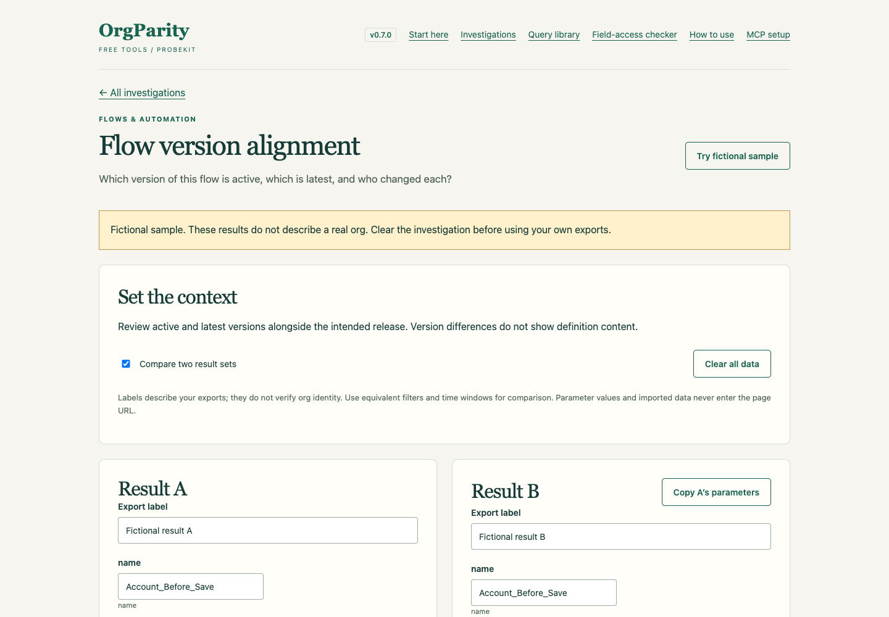

# ProbeKit

A free Salesforce investigation tool by [OrgParity](https://orgparity.com).

[Start here](https://probekit.orgparity.com/start.html) · [Use online](https://probekit.orgparity.com/investigations.html) · [Download](https://github.com/ialameh/probekit/releases/latest/download/probekit.zip) · [Getting started](https://probekit.orgparity.com/getting-started.html) · [Release notes](CHANGELOG.md)

Investigate access, metadata, flows, OmniStudio, operations and data with 61 guided workflows. Build read-only queries, analyse JSON/CSV exports, compare results and download findings. Browser analysis requires no installation or account.



## Investigation workspace

Use the [online workspace](https://probekit.orgparity.com/investigations.html), or build and preview locally with [pnpm](https://pnpm.io/installation) and Node.js 20+:

```sh
pnpm run preview:web
```

Open http://127.0.0.1:4794/investigations.html. All 61 catalogue investigations
support typed parameters, dependent query steps, JSON/CSV imports, scoped evidence
summaries, fictional samples, text/JSON reports and two-export comparison. The
preview command serves local files only; it does not publish or connect to Salesforce.

Use the Standard API or Tooling API indicated on each step. Import complete exports
from the same investigation. Replacing a result invalidates subsequent imports on
that side. An unavailable result blocks dependent checks without treating it as empty.
Comparisons use declared comparison columns where available, otherwise exact
exported columns. Duplicate row counts are preserved; source/configuration columns
are fingerprinted. Equal selected values do not establish whole-org parity.

## Browser field-access checker

[Start an investigation](https://probekit.orgparity.com/field-access.html) without
installing software. Build three read-only queries, paste or select JSON/CSV
exports, and download a findings report. A fictional sample is included.

Results are processed locally in the browser tab and are not uploaded or saved
in browser storage. The checker matches profile and direct permission-set grants;
it does not calculate complete effective access. Group muting, object and record
access, assignment activation and expiry, and screen visibility require separate checks.

Named, reusable Salesforce org probes. A probe answers one question about an org,
the same way every time, and says what the answer means.

## Why

The same questions get asked of an org again and again: who can see this field,
which version is active, is this class the same on both orgs. Each time the query
is rewritten by hand, the traps are rediscovered, and nothing records that it was asked.
A probe captures the question once.

## The library

61 probes in six families. Browse them in [docs/library](docs/library/README.md).

| Family | What it answers |
|---|---|
| access | who can see or do what: field, object, class, tab, record, permission sets, groups, users |
| meta | what exists and who changed it: objects, fields, picklists, Apex, triggers, pages, layouts, dependencies, config |
| flow | which flow versions are active, what fires on an object, what is paused |
| omni | OmniStudio: active versions, steps, compilation, Data Mappers, FlexCards, expression sets, decision matrices, document templates |
| ops | async jobs, schedules, deployments, Setup audit, debug logging, tests, coverage, event subscribers |
| data | any object: one record, find by value, recent changes, field history, duplicates, counts, emails, files |

## Use

[Download ZIP](https://github.com/ialameh/probekit/releases/latest/download/probekit.zip) ·
[Getting started](https://probekit.orgparity.com/getting-started.html)

Extract the ZIP and open `docs/index.html` to browse offline. To start the local
server, install Node.js 20 or newer and run `node probe.mjs web --serve` from the
extracted folder. Open http://127.0.0.1:4791. No project dependencies need installing.
Running probes requires Salesforce CLI authentication and a `.probekit/config.json`
file; the getting-started guide walks through both.

Browse the hosted library at https://probekit.orgparity.com. The hosted page builds
commands and SOQL; running probes against an org still requires the local CLI.

### Publish the web library

`pnpm run build:web` generates `dist/index.html` from the shipped probes only,
excluding project-specific probes and usage logs. Deploy `dist/` to the Cloudflare
Pages project `probekit` (production branch `main`), which serves
`probekit.orgparity.com`:

```sh
pnpm dlx wrangler pages deploy dist --project-name probekit --branch main
```

### CLI commands

```
probe list [family]                  every probe, or one family
probe show <id>                      parameters, steps, traps, recent usage
probe run <id> --org dev [--ticket PROJ-1234] --<param> <value>
probe run <id> --org dev,uat ...     run on several orgs and compare
probe run <id> --org dev --soql ...  also print the exact SOQL sent
probe run <id> --org dev --all-steps ...  run every step, ignoring "when" (to validate a probe)
probe docs --out <dir>               write a markdown page per probe plus an index
probe web --serve [--port 4791]      browse and search the library at http://127.0.0.1:4791
probe web --out library.html         the same page as one offline HTML file
```

The web page searches every probe by object, field, question or trap, filters by family,
and builds the run command and the final SOQL as you type the parameters. Run it from a
project folder to include that project's probes. A copy is kept at [docs/index.html](docs/index.html).

Example:

```
probe run access.field-grants --org uat --obj Account --field Industry --user jane.doe@example.com
probe run flow.versions --org dev,uat --name Account_Before_Save
```

## A probe file

```json
{
  "id": "family.name",
  "question": "One question, in plain words.",
  "family": "access",
  "params":  { "obj": { "type": "sobject", "example": "Account" } },
  "safety":  { "writes": false, "orgs": ["dev", "uat"] },
  "steps": [
    { "name": "first",  "soql": "SELECT ... WHERE SobjectType = '{obj}'", "compare": ["Col"] },
    { "name": "second", "when": "first.rows === 0", "tooling": true, "soql": "..." }
  ],
  "verdicts": [
    { "when": "first.rows === 0", "say": "Nothing on {obj}." },
    { "say": "{first.rows} row(s); first is {= first.records[0].Col}." }
  ],
  "traps": ["Check field-level access as well as object permissions."]
}
```

- **params**: typed and checked before anything runs, which also blocks SOQL injection.
  Types: sobject, field, fields (a comma list), name, username, id, int, text.
  `"optional": true` or `"default": "7"` make a param not required.
- **safety**: declared, not remembered. A probe that writes is refused on read-only orgs
  and needs --allow-write everywhere else. On a production org every query must carry a
  WHERE or a LIMIT.
- **soql templates**: `{param}` fills a value; `[[ AND X = '{param}' ]]` is kept only when the
  param was given; `{@step.Field}` puts an earlier step's values in as a quoted list for `IN (...)`.
- **steps**: run in order. `when` is a JavaScript expression over earlier steps
  (`step.rows`, `step.records`, `step.col('Path')`) and params; helpers `overlap(a, b)`
  and `has('param')`. `hash` replaces long columns (an Apex Body) with a short sha256 so
  orgs can be compared. `compare` names the columns that matter when running on several
  orgs; deployer names and dates are left out by choice. `"compare": "*"` compares every column but Id.
- **verdicts**: the first whose `when` holds is printed. The last one has no `when`.
  `{param}`, `{step.rows}` and `{= expression}` fill in.


Probe files are trusted local config: conditions run as JavaScript.

## Projects

probekit finds `.probekit/config.json` by walking up from the current folder.

```json
{
  "orgs": {
    "dev":  { "alias": "MyDev" },
    "prod": { "alias": "MyProd", "readonly": true, "production": true }
  },
  "probePaths": ["probes"],
  "usageDir": "usage"
}
```

- Generic probes live in this tool under `probes/`. Project probes live in the project's
  `.probekit/probes/`; a project probe with the same id replaces the generic one.
- Every run appends a row to `.probekit/usage/<id>.csv`: when, org, ticket, params, verdict.
  That log is the probe's history of what it was used for.

## Optional MCP integration

The local MCP server exposes investigation discovery, query planning, export analysis
and comparisons to compatible clients. Its dependencies are installed separately;
the browser and CLI continue to work without them. See [MCP setup and usage](docs/mcp.md).

## Test

```
pnpm test
```

## Feedback

[Report a bug or request an investigation](https://github.com/ialameh/probekit/issues/new/choose).
Issues are public: use fictional examples and exclude credentials, org identifiers,
client names and real exports.
